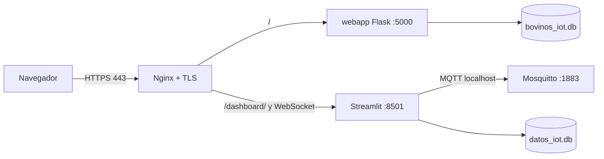

# Diseño: Publicación en servidor STI-ITESHU

## 1. Topología

## 2. Decisiones

- **Flask como raíz:** es el sitio “institucional” del proyecto, con login RBAC, mapa, reportes y APIs.
- **Streamlit bajo `/dashboard/`:** conserva el stack oficial ITESHU sin exponer el puerto 8501 directamente. Se reenvían las cabeceras `Upgrade`/`Connection` para el WebSocket de Streamlit.
- **Mosquitto en `127.0.0.1:1883`:** la ingesta y el gateway LoRa llegan por red interna; nunca se publica el broker sin autenticación.
- **Gunicorn con 1 worker:** `webapp/app.py` inicializa la base al importar; un solo worker evita condiciones de carrera en el sembrado inicial.
- **Volúmenes locales:** `./plataforma/data` y `./webapp/database` se montan en los contenedores para persistir SQLite.

## 3. Seguridad

- `FLASK_SECRET_KEY` se lee de `.env` (no versionado).
- `.dockerignore` evita copiar bases de datos y cachés a las imágenes.
- UFW/Nginx permiten solo 80/443 hacia Internet; SSH se mantiene según política de STI.
- Se documenta cambio de contraseñas de demostración antes de publicar.

## 4. Despliegue sugerido

1. Publicar primero en `bovinos.sti.itsoeh.edu.mx`.
2. Validar con `curl` y navegador.
3. Con autorización, mover el nombre principal `sti.itsoeh.edu.mx` al mismo servidor y retirar ThingsBoard.
4. Mantener el respaldo de ThingsBoard durante al menos una semana.
