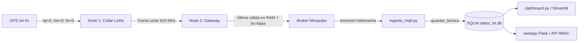

# Diseño Técnico: Corrección de Fail-Safe y Resiliencia

## 1. Flujo de datos corregido

## 2. Matriz de decisión del fail-safe

| Entrada | `fix_valido` | Coordenada persistida/mostrada | Alerta | Semáforo |
|---|---|---|---|---|
| Fix válido y rango correcto | `1` | Coordenada reportada | Ninguna (salvo batería) | Según antigüedad |
| Fix válido pero lat/lon fuera de rango | `0` | Última válida de SQLite (o `0,0` si no existe) | `coordenadas_invalidas` | Amarillo |
| Sin fix (`fix_valido=false`) | `0` | Última válida de SQLite (o `0,0` si no existe) | `sin_fix` | Amarillo |
| Batería < 20 % | Según GPS | Sin cambio | `bateria_baja` | Según GPS |

## 3. Cambios por archivo

### Firmware

- `firmware/nodo_collar_gps/nodo_collar_gps.ino`
  - Sin fix → `latitud = 0.0`, `longitud = 0.0`, `fixValido = false`. Se elimina la coordenada fija de laboratorio.
- `firmware/nodo_gateway_lora_mqtt/config.h`
  - Nuevo `#define LORA_TX_POWER 20`.
- `firmware/nodo_gateway_lora_mqtt/nodo_gateway_lora_mqtt.ino`
  - Variables `ultimaLatValida`, `ultimaLonValida`, `hayFixValido`, `ultimoIntentoMQTT`.
  - Con fix válido se actualiza la memoria de coordenadas; sin fix se reutiliza la última válida.
  - `reconectarMQTT()` pasa a ser **un solo intento por ciclo** con compuerta de 3 s usando `millis()`; se elimina `delay(3000)`.
  - `setup()` configura `LoRa.setTxPower(LORA_TX_POWER)`.

### Backend y base de datos

- `plataforma/src/database.py`
  - `guardar_lectura()` calcula `fix_valido` considerando rango geográfico; si es inválido busca la última lectura válida del mismo `device_id`/`animal_id` y la reutiliza; crea alerta `sin_fix` o `coordenadas_invalidas` (sin duplicados abiertos para el mismo dispositivo).
  - `obtener_ultimas_ubicaciones()` ignora registros `(0,0)` sin fix al elegir la última posición y fuerza semáforo amarillo cuando `fix_valido=0`.
- `plataforma/src/ingesta_mqtt.py`
  - Ya no descarta coordenadas fuera de rango: las marca `fix_valido=False` y delega el fail-safe a `guardar_lectura()`.

### Webapp Flask

- `webapp/app.py`: `from datetime import datetime`; `debug=False`; secreto leído de `FLASK_SECRET_KEY` con valor por defecto solo para desarrollo.
- `webapp/requirements.txt` (nuevo): Flask y Werkzeug.
- `webapp/iniciar_webapp.bat`: instala dependencias antes de arrancar.

### Documentación y repositorio

- `README.md`: guía ampliada de arquitectura, puertos, credenciales de demostración, pruebas, contrato MQTT y flujo OpenSpec.
- `.gitignore`: reglas reforzadas para `*.db`, `*.sqlite*`, `.env*`, `__pycache__/`, `*.pyc`.
- `plataforma/requirements.txt`: `paho-mqtt>=2.1.0,<3`.

## 4. Compatibilidad

- No hay cambios de esquema SQL: los tipos de alerta ya estaban previstos en el DDL (`sin_fix`) y se añade `coordenadas_invalidas` como valor de texto, sin migración.
- El contrato MQTT conserva los campos y tópicos existentes; `fix_valido=false` pasa a tener significado explícito de “posición retenida, no confiable”.
- El simulador sigue emitiendo solo tramas válidas, por lo que las pruebas de regresión no se alteran.
