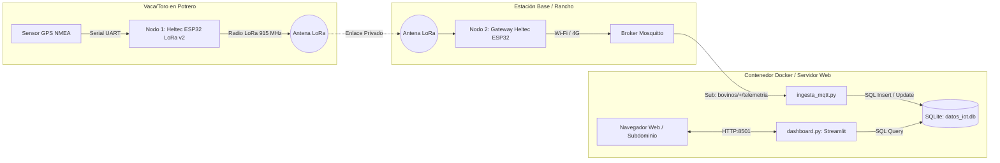

# Diseño Arquitectónico: Plataforma de Monitoreo GPS de Bovinos

## 1. Diagrama de Bloques del Sistema

## 2. Esquema Relacional de Base de Datos (SQLite)
- `ranchos`: id, nombre, municipio, estado, activo.
- `usuarios`: id, username, password_hash, rol (admin, ganadero, tecnico), nombre_completo.
- `dispositivos`: id (device_id), modelo, mac_address, tipo (collar, gateway), bateria_pct, rssi, estado_conexion, ultima_comunicacion.
- `animales`: id (animal_id), arete_siniga, nombre, categoria (toro, vaca, novillo), rancho_id, device_id, estado (activo, extraviado, vendido).
- `lecturas_gps`: id, animal_id, device_id, lat, lon, altitud, velocidad, satelites, fix_valido, timestamp.
- `alertas`: id, animal_id, device_id, tipo (desconexion, bateria_baja, sin_fix), descripcion, nivel (info, warning, critical), atendida, atendida_por, notas, created_at.

## 3. Estrategia de Despliegue y Contenedorización
- Empaquetado en imagen Docker ligera basada en `python:3.11-slim`.
- Uso de `docker-compose` para orquestar la plataforma web (Streamlit en puerto 8501) junto con el proceso daemon de ingesta MQTT.
- Persistencia mediante volumen mapeado en `./data:/app/data` para garantizar la durabilidad de los datos ante reinicios.
- Publicación mediante túnel seguro (Cloudflare Tunnel) o Proxy Inverso Nginx para asignación inmediata de subdominio HTTPS sin apertura vulnerable de puertos en el enrutador.
